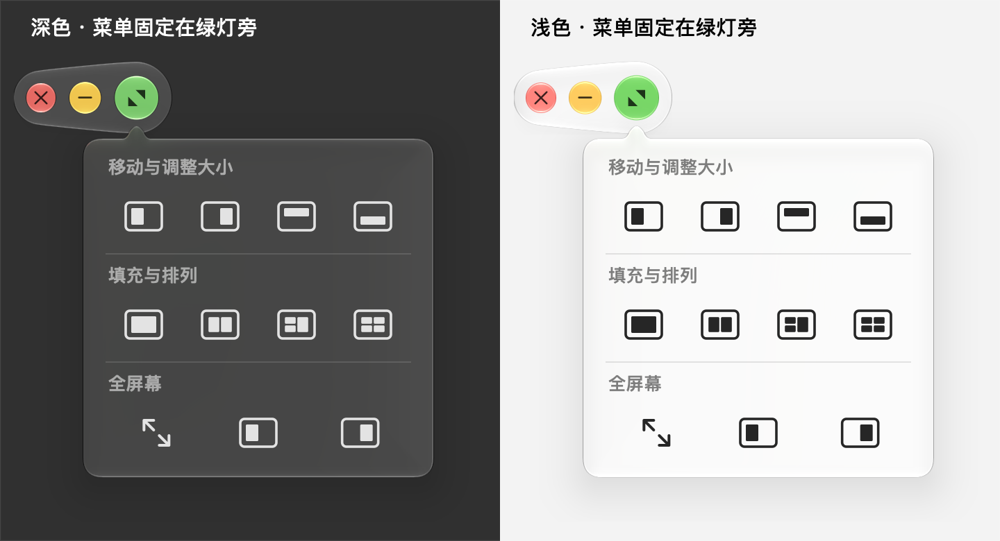

# 固定在放大绿灯旁的窗口菜单

验证日期：2026-11-11。

悬停绿灯后，菜单以当前可见绿灯的中心作为锚点，在其下方弹出。位置只在打开时计算一次；进入菜单后，胶囊保持展开，按钮停止跟随指针缩放，菜单本身也不移动。屏幕底部空间不足时改在上方显示，靠近左右边缘时限制在可见屏幕内。

图中为本机原生视图渲染的演示窗口，使用实际生产的胶囊和菜单组件；演示中没有操作用户的窗口。

## 原生菜单定位实验

旧实现向原生绿灯发送 `AXShowMenu`。菜单由 `ThemeWidgetControlViewService` 绘制，锚定原生绿灯，而放大的按钮位于独立覆盖面板中，因此两者出现偏移。

本机 macOS 27.2.1 的测试菜单位置为 `(342, 273)`。`AXUIElementIsAttributeSettable` 报告其 `AXPosition` 不可写；试着设为 `(366, 285)`，接口返回成功，但立即、0.2 秒和 0.8 秒后读取的 AX 坐标及 WindowServer 坐标都仍为 `(342, 273)`。该菜单没有可移动的 `AXWindow` / `AXTopLevelUIElement`，其公开动作只有 `AXCancel`。不能把 setter 的成功返回值当作已经移动成功。

## 新菜单与操作

经用户选择，改为应用自己的非激活面板。背景仍使用系统 Liquid Glass；菜单轮廓、图标和位置由项目提供。新面板不会抢走目标应用的焦点，透明阴影区域不会拦截绿灯点击。

- **移动与调整大小**：左、右、上、下；按住 Option 切换为四角布局。
- **填充与排列**：填充、左右排列、三窗口排列、四等分排列。
- **全屏幕**：进入 / 退出全屏、全屏平铺到左侧、全屏平铺到右侧。三个入口直接显示在底部。

平铺和排列优先通过目标应用“窗口”菜单的 AX 标识定位系统命令，选择时重新读取并验证命令可用状态以及原目标窗口仍处于前台。真实测试中 `_zoomLeft:` 与 `_zoomFill:` 保留了系统的 8 pt 平铺边距。没有调用这些名称对应的私有 Objective-C 方法。

个别应用没有标准“窗口”菜单时，只为其可调整大小的普通窗口提供单窗口位置 / 尺寸后备操作；不会把调整一个窗口伪装成多窗口排列或 Split View。不可用操作显示为禁用状态，悬停可查看说明。全屏通过原窗口的 `AXFullScreen` 属性执行。

鼠标离开按钮和菜单区域后延迟 0.25 秒关闭，点击外部、键盘输入、原窗口移动 / 隐藏或失去前台资格时关闭。旧的异步请求失效后不能再弹出菜单。菜单窗口也加入本应用的遮挡排除集合，避免菜单打开后反过来隐藏胶囊。

## 验证结果

- **123 项 Swift 测试通过**：包括新菜单锚点、负坐标显示器、左右边缘、向上弹出、透明阴影的点击穿透、禁用动作和一次点击只派发一次操作；原有胶囊、应用名单与按钮回归测试保留。
- 使用独立的标准 AppKit 测试应用，经实际 `WindowOverlay` 的悬停路径打开菜单，确认目标窗口保持前台，菜单不成为键盘焦点窗口。改变输入指针坐标后菜单窗口位置保持不变。
- 经新菜单的按钮回调实际执行左半屏，得到窗口位置 `(8, 41)`、尺寸 `(744, 933)`；执行填充，得到 `(8, 41)`、尺寸 `(1496, 933)`。
- 经新菜单进入全屏，确认 `AXFullScreen=true`，随后恢复 `false`。测试窗口在检查后关闭。
- 多窗口排列与左右 Split View 的命令标识和启用状态已经核对；未实际重排用户的其他窗口。多显示器边界由几何测试覆盖，未声称完成真实多屏操作。
- 发布构建、签名与安装产物一致性随本次安装检查；保留应用名单和原有配置。
