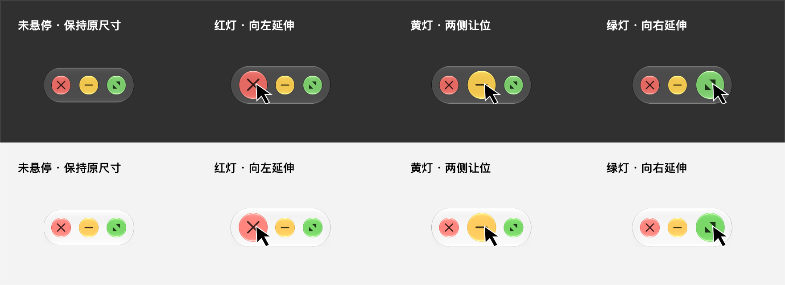
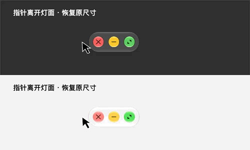

# 分段悬停、轻微吸附与完整胶囊

> 本文记录第一版分段交互。后续已改为连续间隙命中、两端同心和固定材质画布，当前行为及验证见 [交互精度修正](precision-hover-capsule.md)。

验证日期：2026-11-14。

## 交互规则

取消原先随距离连续变化的多灯缩放，也移除指针附近的局部气泡轮廓。现在只有进入某颗灯的实际圆形区域，才把该灯设为放大目标；间隙、圆形外的四角和胶囊留白不产生放大目标。

- **红灯**：向左长大，胶囊左端延伸；黄、绿灯维持原尺寸和位置。
- **黄灯**：居中长大，红、绿灯保持原尺寸，向两侧等距让位；胶囊左右都加长。
- **绿灯**：向右长大，胶囊右端延伸；红、黄灯维持原尺寸和位置。
- **吸附**：仅悬停灯轻微向指针靠近，位移最多 2 pt；胶囊跟随该位移的四分之一。放大量不再随指针在灯内的位置改变。

胶囊始终使用标准圆角胶囊路径，上下对称，只小幅增加整体高度以容纳放大的灯。缩放倍率沿用 1.45 倍；本机使用的 23 pt 基础尺寸按钮增大到约 33.35 pt，居中悬停时胶囊高度从 39 pt 增加到约 42.62 pt。

状态目标是离散的，尺寸和位移以 45 ms 时间常数的指数缓出过渡，约 135 ms 完成 95% 的变化，没有超调或回弹。离开时平滑恢复；快速换灯时，上一颗灯收回、下一颗灯展开。整组隐藏式展开与收起的曲线保持原有行为。

图片与录屏来自本机原生组件，不是概念效果图。录屏中使用程序化指针轨迹驱动生产布局和动画，指针图案只在演示面板内绘制，没有向系统注入输入事件。

## 定位与输入

悬停命中使用当前画面中的圆形按钮区域。吸附目标参照选中状态下尚未吸附的位置，避免位移反过来影响下一次位移计算，造成静止指针下的抖动。

吸附位移与按钮缩放一起缓出，最终精确归零并停止动画定时器。按钮绘制与点击区域使用同一帧几何，承载窗口保持固定，避免窗口取整带来的末段中心跳动。

外侧按钮可略微越过目标窗口边缘；布局约束放在所在显示器的边界，避免红灯一放大就把整组推向右边。贴近显示器边缘且空间不足时，整体适当让位以保持可见。菜单打开时继续冻结胶囊和按钮，保持既有的固定绿灯锚点。

## 已完成验证

- 125 项 Swift 测试通过，包括单灯目标、间隙、圆形四角、红绿向外伸展、黄灯对称让位、吸附上限、按钮包容性、状态反转、减少动态效果和固定菜单。
- 在 18、23、48 pt 基础尺寸下检查状态之间的中间帧，按钮圆周与留白均位于标准胶囊内，承载区域不变。
- 指针静止在每颗灯边缘的 12 个方位时，经过整个放大过程仍保持同一悬停目标，不发生放大 / 收回的循环。
- 对独立 AppKit 测试窗口运行实际 `WindowOverlay`，逐一验证三颗灯的尺寸、两侧让位、AppKit 坐标中的吸附方向、视图命中、固定承载窗口和移开后的精确还原。
- 深浅色动画演示的 490 帧逐帧检查承载窗口不变、实际视图位置与布局相符、点击目标对应正确。

这些检查覆盖本次几何和交互修改；录屏采用可重复轨迹，不能替代用户对手感的判断，也不代表已完成所有第三方应用和真实多屏组合的测试。
