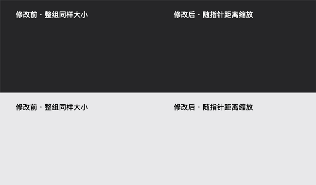
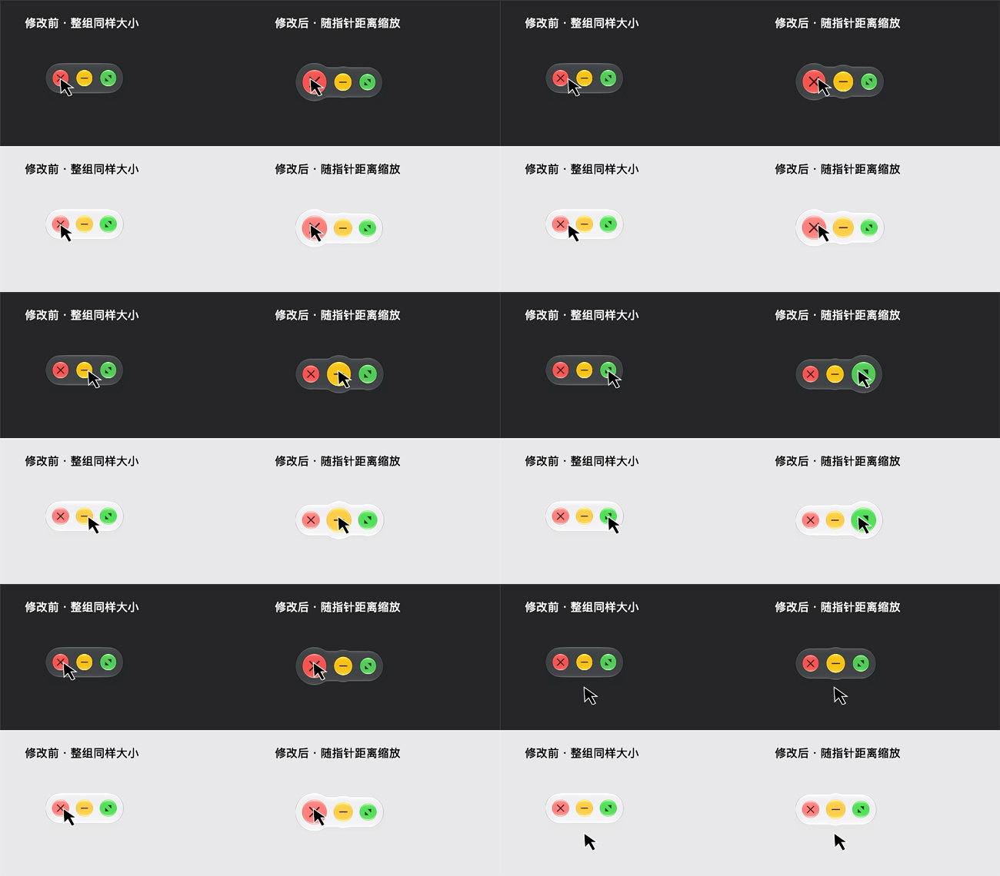

# 按距离独立放大红绿灯

验证日期：2026-11-11。

液态玻璃模式保留原有整组展开/收起，展开后每个按钮独立响应指针距离。接近红、黄、绿中的某一个，那个按钮逐渐变大，相邻按钮稍微放大并让出空间。移开时恢复普通尺寸；隐藏式模式随后收起整组。

这是实际 AppKit 玻璃视图的本机录屏。左侧为修改前，右侧为修改后；上方深色，下方浅色。演示指针由测试程序绘制，路径可重复，没有向系统注入鼠标操作。

## 距离与动画

- 大小沿用全局滑杆作为基础直径；本机 23 pt 的按钮最大约为 33.35 pt，即 1.45 倍。
- 影响范围为一个基础按钮间距的 1.35 倍，使用余弦曲线从最近点的最大权重平滑下降至零。水平和垂直距离都参与计算，两个按钮之间没有“切换选中项”造成的尺寸突变。
- 距离基于稳定的基础布局计算，避免按钮变大后中心移动，反过来影响下一帧大小而产生反馈抖动。
- 每个按钮使用时间常数 55 ms 的指数缓出跟随当前目标。指针静止后约 127 ms 完成 90% 的变化；不超调、不回弹，反向后立即趋向新目标。
- 相邻按钮保持 8 pt 间隔。最大尺寸预先决定透明承载窗口的大小，实际按钮和材质只在这个固定窗口内部移动与缩放，避免窗口取整导致末段晃动。
- 更新按钮尺寸的同时更新实际点击区域；按钮之间及胶囊留白仍允许标题栏点击穿透。遮挡、最小化、单个应用禁用等路径会撤下整组并清理缩放状态。
- 指针停稳且动画结束后停止帧定时器；新的指针事件再次唤醒更新。系统“减少动态效果”下直接采用当前目标尺寸。

## 原生胶囊变形

外层使用 `NSGlassEffectContainerView` 将一个胶囊连接部分与三个可变半径的圆形玻璃区域融合。哪个按钮放大，胶囊就在对应位置鼓起；轮廓高光和折射仍由系统渲染。API 的融合机制见 [Apple 的容器说明](https://developer.apple.com/documentation/appkit/nsglasseffectcontainerview/contentview)。

材质实验发现：若把彩色按钮的玻璃视图嵌入各圆形背景，内部玻璃会干扰外层融合，出现圆形接缝。当前实现让外层融合容器只处理无色背景，彩色按钮作为前景独立绘制，从而保持连续外轮廓和已有按钮染色。

macOS 26 以前及“降低透明度”模式沿用后备材质，外框随按钮组宽高变化；局部轮廓融合由 macOS 26+ 的原生玻璃提供。

## 已执行验证

- 115 项 Swift 测试通过。新增覆盖距离曲线、按钮之间连续过渡、双向无回弹、反向跟随、30/60/120 Hz 一致性、精确收敛、减少动态效果、缺失按钮、18/23/48 pt 布局及窗口左右边缘。
- 实际 AppKit 视图在深浅色下累计检查 612 个可见帧：承载窗口固定、视图中心与预期几何一致、点击测试命中对应按钮、面板不成为键盘焦点窗口。
- 本机录屏覆盖展开、依次经过三个按钮、快速反向、远离和收起。静态采样见下图。
- 发布构建、签名及安装产物一致性检查随本次安装执行。应用名单规则沿用已有设置。

