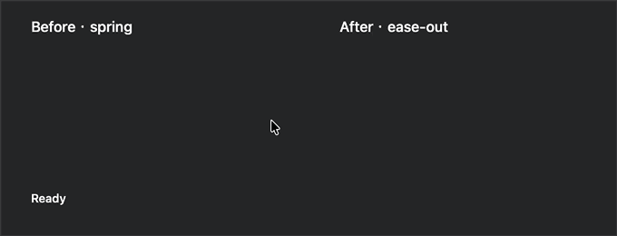

# 先快后慢、无回弹的胶囊动画

2026-11-11 新增了 [按指针距离独立放大按钮与胶囊变形](dock-magnification.md)。本文的三次缓出仍用于整组出现/收起，按钮在展开后的独立缩放采用新的连续缓出跟随。

2026-11-10，根据用户对指针追踪体验的反馈，取消胶囊展开时的超调、回弹，改为单向减速到位。

这是本机 macOS 27.2.1 上实际 `GlassGroupPanel` 的录屏，23 pt 按钮，正常速度播放。左右共用当前的玻璃材质与配色；左侧使用 `e7ffc6b` 的弹簧和布局，右侧使用本次缓出实现。第二次展开包含快速退出、重入。

## 交互

- 展开和收起采用三次缓出 `1 − (1 − t)³`。开头响应快，随后连续减速，终点速度为零；尺寸不会超过目标，也不会在结束后反向回缩。
- 完整展开 0.24 秒，前 0.08 秒完成约 70%，前 0.16 秒完成约 96%；完整收起 0.18 秒。保留原有的 0.10 秒离开宽限期。
- 动画中途反向时保留当前尺寸和位置，并立即朝新目标运动，不保留朝旧目标运动的惯性。短距离过渡按剩余距离的平方根缩短时长。
- 按钮的位置、尺寸、间隔和胶囊内边距使用同一进度。移除为回弹设计的独立中心曲线，避免整体尺寸已单调变化时，个别按钮仍出现短暂反向移动。
- 保留固定透明窗口、内部玻璃视图变化的方案，防止顶层窗口边界取整再次导致末段跳动。系统“减少动态效果”和常显模式仍直接到位。

这是本项目调节的交互曲线，不声称调用了 Apple 私有控件的动画参数。

## 验证

- 完整发布构建、99 项 Swift 测试和签名验证通过。
- 将此前要求弹簧超调、保留惯性的测试更新为：进度始终位于 0…1，同一目标下每帧变化量逐渐减小，终点精确停止，反向时不继续沿旧方向移动。
- 保留并更新 30 / 60 / 120 Hz、丢帧、快速反向、减少动态效果、窗口两侧、负坐标和实际 AppKit 视图对齐检查。
- 18 / 24 / 28 / 48 pt 的按钮中心沿单向路径到达最终位置；23 pt 本机录屏中胶囊最大为预设的 101 × 39 pt，没有超过目标。
- 录屏程序在 163 个可见帧检查了无超调、单调进度、实际视图中心、点击区域和非激活窗口状态。

此次验证聚焦动画和几何，没有重复验证 Finder 的原生绿灯菜单或多显示器切换。
