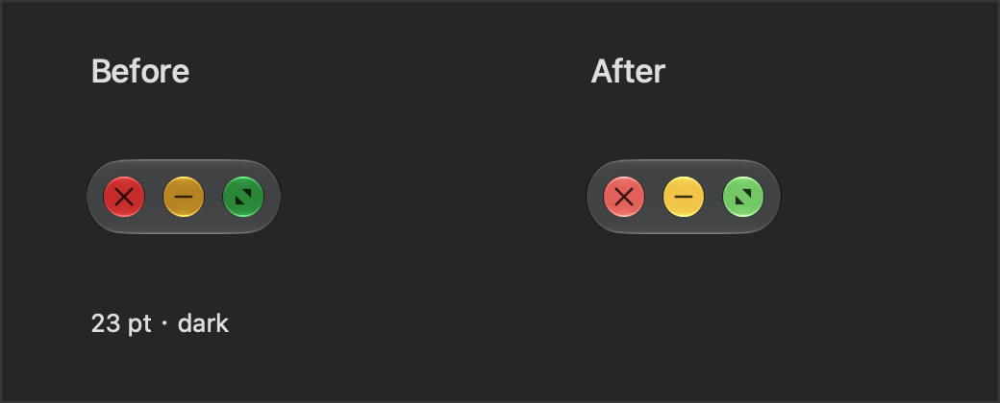
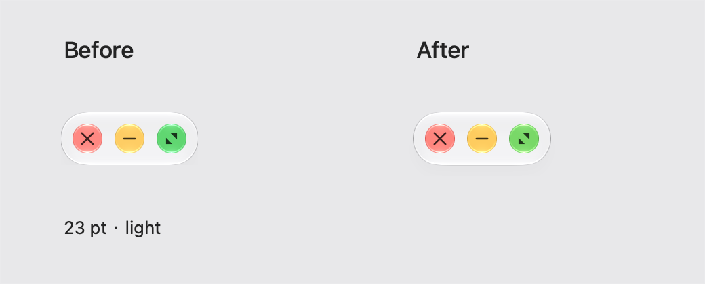

# 玻璃按钮颜色校准

2026-11-10，修正玻璃红绿灯相比正常系统按钮偏深、偏饱和的问题。

以上为本机 macOS 27.2.1 上实际 `GlassGroupPanel` 的截图，按钮直径 23 pt。左侧编译自 `14c628f`，右侧使用本次代码；截图没有做颜色增强。

## 原因与调整

`NSGlassEffectView.tintColor` 是系统玻璃合成的输入，不能直接等同于平面圆片的填充颜色。此前把普通红绿灯的 RGB 直接用于半透明 `.clear` 材质，在深色背景下渲染成明显偏深、偏浓的颜色。悬停又将染色 alpha 从 0.74 提升到 0.82，按下时提升到 0.90 并混入黑色，进一步加重了切换时的视觉落差。

本次只调整液态玻璃按钮的染色：

- 深色模式使用更浅、饱和度更低的染色输入，并分别校准三个颜色的强度，提亮实际渲染后的红色、黄色和绿色。
- 浅色模式使用单独的校准参数；绿色略向暖色调整，减少偏冷、偏浓的观感。
- 普通与悬停使用相同颜色。按下只小幅调整透明度，使亮度轻微降低，不再叠加浓色和黑色。
- 原生玻璃材质继续负责圆形轮廓、高光和透光；经典外观、不透明后备画法和禁用/未激活灰色逻辑沿用原实现。

在深色中性背景的无符号色块实验中，中心区域 sRGB 中位数如下。它们是本组背景下的屏幕采样值，不是直接写入视图的 RGB；背景和系统合成仍会影响实际颜色。

| 按钮 | 修改前 | 修改后 |
| --- | --- | --- |
| 红 | `(215, 9, 29)` | `(244, 85, 84)` |
| 黄 | `(191, 129, 0)` | `(247, 194, 23)` |
| 绿 | `(0, 137, 41)` | `(82, 202, 88)` |

## 验证

- 完整发布构建、99 项 Swift 测试和签名验证通过。
- 先使用 AppKit 标准窗口按钮作为颜色参考，比较深浅色模式的候选染色；最终再用实际编译出的按钮视图与上一版对照。
- 检查深、浅色模式各自的普通、悬停、按下、禁用状态，共 8 组实际截图。玻璃高光保留，悬停不再突然加深，禁用按钮仍显示为灰色。
- 本次没有修改动画、按钮布局、命中逻辑或窗口操作。
