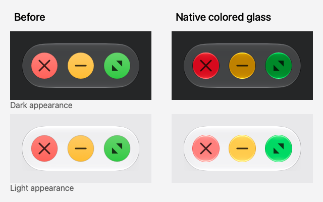

# 三个按钮改用原生彩色玻璃

2026-11-10，在上一版已恢复胶囊原生高光的基础上，调整红、黄、绿三个按钮的材质。

本文记录首版原生彩色玻璃（`aae729e`）。后续已根据实际使用反馈，校正偏深、偏饱和的颜色与悬停染色，当前配色见 [按钮颜色校准](glass-button-color.md)。

以上为本机 macOS 27.2.1 上 28 pt 按钮的真实截图。外层胶囊的配置相同，左侧是原有实色圆片与手绘渐变，右侧是新的原生彩色玻璃。截图仅做等比例排列，没有额外增强高光。

## 实现

- 每个 `OverlayButtonView` 内复用一个 `NSGlassEffectView`，采用 `.clear` 和半透明 `tintColor`。圆形轮廓、透光和边缘高光由 AppKit 绘制。
- 外层胶囊仍是 `.regular`，保留上一版已确认有效的活动外观处理；本次没有增加新的私有 API。
- 普通、悬停、按下时的颜色强度分别为 0.74、0.82、0.90，按下时稍微压暗。失去活动状态且未悬停时呈现中性灰色玻璃；禁用时降低显示强度。
- 符号放在各自玻璃的 `contentView` 内，保留现有图标、尺寸和行为映射，并在动画改变尺寸时重绘。
- 材质及符号子视图不接收鼠标命中，也不产生重复的辅助功能按钮；原来的 `OverlayButtonView` 继续负责点击、悬停、取消和辅助功能标签。
- 设置预览复用同一个按钮视图，因此与实际覆盖层一致。旧系统或开启“降低透明度”时使用原有的实色后备画法。

## 验证

- 完整构建和 91 项 Swift 测试通过；其中点击匹配测试分别覆盖经典和液态玻璃两种外观。
- 新增回归检查：14 / 18 / 28 / 48 pt 尺寸下，玻璃子视图不截获按钮点击；悬停和尺寸变化复用已有材质；切回经典外观会移除原生玻璃。
- 使用构建出的实际 `GlassGroupPanel` 检查浅色、深色、未激活灰色、悬停、按下及禁用状态。
- 既有胶囊高光、按钮布局、展开/收起时间线和原生窗口操作保持原来的实现。

本轮着重检查材质和输入命中，没有对多窗口长期 GPU 开销作基准测试。每个按钮的材质会复用，未在每个动画帧重建。
