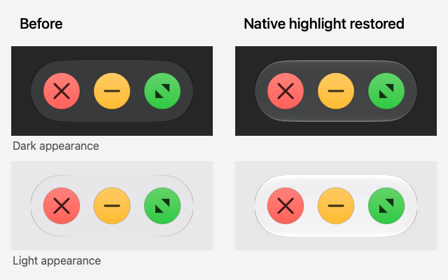

# 原生 Liquid Glass 高光缺失：定位与修复

2026-11-10，在本机 macOS 27.2.1（26B131）、Retina 显示器上验证。

## 结论

`NSGlassEffectView` 已经在正常工作，但承载它的 `GlassGroupPanel` 是一个永不成为 key/main window 的非激活面板。AppKit 因此使用玻璃的非活动外观，抑制了边缘高光。原生红绿灯造成的背景取色是另一个问题；遮住原生按钮只能解决色染，不能恢复活动玻璃的高光。

修复保留 `NSGlassEffectView.Style.regular`，只让玻璃面板向 AppKit 报告活动外观。胶囊的高光、明暗和材质仍完全由系统绘制，没有新增描边、渐变边框或自制光效。



图中是屏幕截图的等比例裁剪与排列，未绘制或增强玻璃边缘。左侧采用修复前的面板配置，右侧使用构建后的实际 `GlassGroupPanel`。两个面板均不获取键盘焦点。

## 对照过程

第一组实验在同一深色背景和同一位置，使用 116 × 44 pt 的原生玻璃与同样的三色内容，逐一改变单个条件：

| 条件 | 原生高光 |
| --- | --- |
| 原配置：非激活面板，`cornerRadius = 999` | 缺失 |
| 半径改为实际高度的一半 | 仍缺失 |
| 面板四周增加 16 pt 透明留白 | 仍缺失 |
| 切换 `.clear` | 仍缺失 |
| SwiftUI `.glassEffect(.regular)`，包括交互变体 | 仍缺失 |
| 添加 `NSGlassEffectContainerView` | 仍缺失 |
| 相同玻璃放进正常的 key window | 出现 |
| 临时允许测试面板成为真正的 key window | 出现，但这会取得焦点，未用于产品 |
| 非激活面板，仅覆盖 `_hasActiveAppearance` | 出现，真实 key window 保持不变 |

补充验证了浮动/utility/HUD 面板、`NSVisualEffectView.state = .active`、SwiftUI 的 `appearsActive` / `controlActiveState` 等设置，在本机均未恢复覆盖面板的高光。它们没有进入产品实现。

第二组实验链接本项目构建出的实际 `GlassGroupPanel`，并排呈现修改前配置和修改后面板。深色、浅色、整个测试应用失去焦点时，修复后的面板均保留系统高光。

## 实现及边界

```swift
// GlassGroupPanel 依旧永不获取键盘焦点。
override var canBecomeKey: Bool { false }
override var canBecomeMain: Bool { false }

@objc(_hasActiveAppearance)
private func glassHasActiveAppearance() -> Bool { true }
```

`_hasActiveAppearance` 是 **AppKit 未公开的外观钩子**，不是公开 SDK 的配置项。此定制版在自己的 `NSPanel` 子类上实现该方法；不注入其他应用，不修改系统库，不调用 `makeKey` / `makeMain`，不伪造 `isKeyWindow`，也不修改玻璃内部图层。

这个兼容办法只影响本应用的玻璃面板。如果未来 AppKit 不再查询此方法，面板会回到系统默认的非活动外观；大版本升级后需要重新检查高光。它不应被描述为 Apple 保证支持的公共 API 方案。

## 验证记录

- `Build-Liquid-Glass.command` 构建成功，90 项 Swift 测试通过。
- 应用本机 ad-hoc 签名及 `codesign --verify --deep --strict` 通过。
- 生产面板在 18 / 28 / 48 pt 三种按钮尺寸下，三个按钮的命中区域均与实际视图一致。
- 界面观察中底层窗口保持 key，覆盖面板的 `isKeyWindow` 保持 false；按钮动作及底层文本输入仍可执行。
- 浅色、深色和测试应用不活动时的截图均已检查。

本次只修复玻璃外观，保留现有按钮尺寸、展开/收起逻辑、取色遮罩和鼠标穿透策略。
