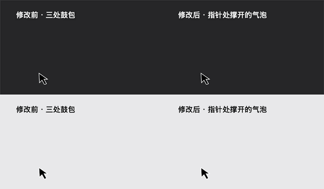
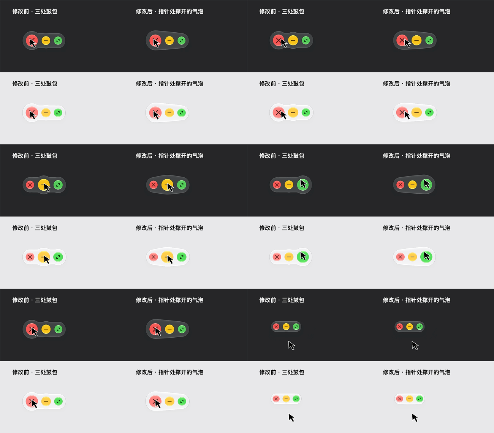

# 指针附近撑开的连续玻璃胶囊

验证日期：2026-11-11。

胶囊保留完整、圆滑的外沿。指针靠近一端时，该端鼓起，另一端变化较小；经过中间时，中部形成一段宽而平缓的弧线。上下方向也根据指针位置有轻微偏移。每个按钮仍按距离独立放大，继续使用先快后慢、无回弹的动画。

这是本机实际原生玻璃视图的录屏：左侧为 `e4aa5c0` 的融合圆形外壳，右侧为本次连续气泡轮廓，上方深色、下方浅色。指针由测试程序绘制，按可重复路径驱动实际生产布局与渲染代码；没有向系统注入鼠标操作。两个版本使用同一套按钮缩放参数。

## 原因与修改

旧版通过一个连接胶囊和三个圆形玻璃区域融合外壳。按钮半径不同以后，圆形区域之间产生局部收腰，外观像串起来的三个气泡。单纯把整颗圆角矩形加高，也不能表达以指针为中心的局部撑开。

新版把三个按钮的留白和一个跟随指针的支撑圆包进**同一条凸轮廓**。轮廓没有向内的凹槽，用相切的二次曲线连接，避免灯之间出现小山峰和细腰。支撑点的水平位置跟随指针；垂直方向保留轻微偏移，让靠近指针的一侧鼓起得更多。支撑点与按钮尺寸使用同样的 55 ms 指数缓出，不另外叠加弹簧或隐式动画。

外轮廓由项目计算，**玻璃材质、折射与高光由系统绘制**。macOS 26+ 使用 SwiftUI 官方的 [`glassEffect(_:in:)`](https://developer.apple.com/documentation/swiftui/view/glasseffect(_:in:)) 将 Liquid Glass 应用到自定义 `Shape`。它由透明 `NSHostingView` 承载；彩色按钮仍使用已有的 AppKit 玻璃视图和点击区域。没有手绘亮边，也没有通过裁切普通圆角玻璃来伪造轮廓。

透明承载窗口预先多保留 4 pt 空间，动画过程中仍固定不动。实际玻璃、原生灯遮罩与按钮都使用同一坐标换算。旧系统的磨砂后备材质和“降低透明度”下的不透明外壳也采用同一轮廓。

## 验证

- 119 项 Swift 测试全部通过，包含原有缩放、开合、点击区域、应用名单与定时器回收检查。
- 新的轮廓检查覆盖 18 / 23 / 48 pt 基础尺寸、水平扫过三个按钮、上下偏移和部分展开：边缘保持凸形，按钮及留白被包含，形状不越出固定承载窗口。
- 局部形变检查确认近端更鼓、远端较小；上下偏移改变鼓起方向；无影响时准确恢复普通胶囊。
- 实际 AppKit / SwiftUI 视图在深浅色下累计检查 610 个可见帧：承载窗口固定、按钮屏幕位置与布局一致、点击测试命中正确按钮、面板不成为键盘焦点窗口。录屏包含依次经过三个按钮、上下偏移、快速反向、远离及收起。
- 完整发布构建、签名检查和安装产物一致性验证随本次安装执行。应用名单和原有配置保留。

这些检查验证的是本机渲染与几何行为，没有将演示指针视为实际用户点击，也不代替不同第三方应用或多显示器环境下的长期试用。

