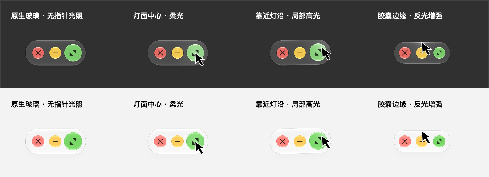
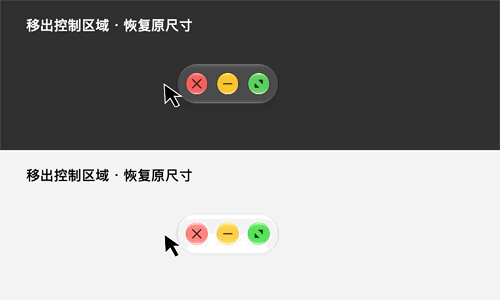

# 指针光照、黄灯微动与独立菜单交互

验证日期：2026-11-14。

## 交互变化

- 黄灯吸附时，胶囊按黄灯垂直位移的 30% 微动，最大约 0.6 pt。红、绿灯的位置不受影响；胶囊半径不随上下移动伸缩。
- 窗口布局菜单打开后，仅菜单自己的锚点固定。三颗灯继续独立缩放、吸附、响应点击和光照；进入菜单区域时胶囊仍保持可见。
- 覆盖面板先以原生小灯的几何完成透明预布局，提交内部图层，再开始显现。SwiftUI 路径坐标使用已知的画布高度，避免依赖首次布局期间的临时尺寸。

## 顶部首帧错位的实际原因

胶囊为原生高光保留了透明外边距。靠近屏幕顶部时，这部分透明区域会超过 `NSScreen.visibleFrame` 的上边缘。AppKit 首次显示窗口时自动把整个覆盖面板向下挪动，而内部按钮仍使用挪动前的位置；下一次布局才补偿回来。

旧、新实现使用同样的顶部测试位置、按钮几何和承载尺寸，对照结果如下。单位为 pt，负值表示低于目标位置：

| 读取时机 | 旧实现按钮垂直偏移 | 新实现按钮垂直偏移 |
| --- | ---: | ---: |
| 首次显示后立即读取 | -22 | 0 |
| 等待 80 ms，不重新布局 | -22 | 0 |
| 第二次布局后 | 0 | 0 |

现在 `GlassGroupPanel` 与 `ZoomMenuPanel` 保留显式计算的窗口 frame，避免系统再次根据透明外边距挪动窗口。可见按钮和菜单仍由各自布局负责屏幕边界约束。菜单的实际绘制位置与阴影穿透命中区域也因此保持一致。

完整坐标记录见 [顶部对照记录](glass-pointer-light/screen-edge.txt)。屏幕中部的普通反复开合并不能覆盖这个问题，因此增加了屏幕顶部的实际 AppKit 回归测试。

## 指针光照

原生玻璃继续负责背景、折射及基础高光；项目自定义的局部光照叠加在材质上，符号绘制在光照之上。

- 胶囊和三个按钮共享同一个屏幕坐标光源，分别转换到本地坐标，保持照射中心一致。
- 指针附近有柔和的白色径向光斑，另有较小的中心亮点。
- 根据指针到实际轮廓的距离增强边缘反光。光照沿真实胶囊路径或按钮圆形裁切，边缘处叠加宽、窄两层局部反光，没有常亮的额外整圈描边。
- 光源离开后在原位置淡出，不追逐已经离开的指针。达到静止状态后停止专用动画计时；减少动态效果开启时直接切换强度。
- 光照图层不参与命中和辅助功能，视觉间隙仍连续接管悬停及点击。

图像来自本机原生组件；录屏使用程序化指针轨迹驱动生产布局、动画和光照，没有向系统注入鼠标事件。

## 验证结果

- **137 项 Swift 测试通过**：覆盖光照淡入淡出与停止、真实轮廓边缘强度、像素裁切、输入穿透、反复原位预布局、顶部首次显示及菜单阴影外边距，以及已有交互回归。
- 实际 `WindowOverlay` 在独立标准 AppKit 测试窗口中打开菜单后，依次把红、黄、绿灯放大，菜单保持可见且 frame 不变；黄灯上下吸附时胶囊随动，红、绿灯 frame 不变。
- 反复展开演示检查了 324 次布局更新；顶部专门用例稳定复现并消除了 22 pt 首帧挪位。
- 指针光照演示检查了 490 次原生视图更新中的固定承载窗口和命中位置，另检查深浅色静态效果。

这些检查覆盖当前 Mac 上的实现和所列场景，不代表完整覆盖所有第三方窗口、系统版本和真实多显示器组合。
