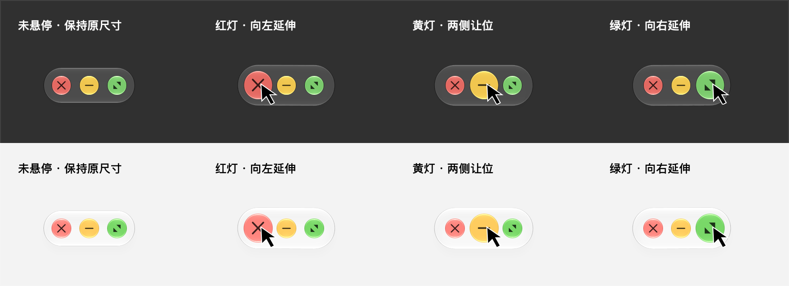
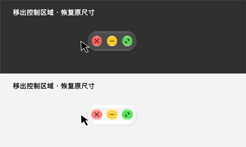
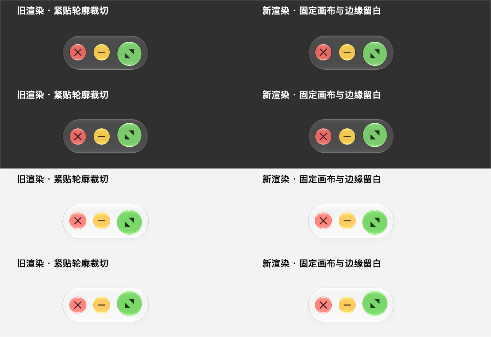

# 连续交互、同心端头与固定玻璃画布

验证日期：2026-11-14。

## 修正的问题

上一版只在圆形按钮内部命中，视觉间隙会使三个按钮都回到未悬停目标。胶囊的背景尺寸又随指针上下位置改变，背景中心和端头半径独立于按钮计算；在显示器边缘，对胶囊进行整组位置修正会连带移动未选中的按钮。

在同一组 23 pt 基础尺寸、绿灯上画圈的几何对照中，旧版未选中红灯的横向位置变化为 **0.5 pt**，胶囊右半圆与绿灯圆心的最大距离为 **4.86375 pt**。新版相同轨迹的两项结果均为 **0 pt**。

## 当前交互

- 三个圆形按钮与中间的短连接区域组成连续的悬停和点击区域。左右滑动始终选中一颗灯，不会在间隙掉回全部收起；外侧留白仍允许标题栏操作。
- 放大时优先利用原有的 8 pt 间隙。23 pt 基础尺寸、单灯完全展开且未吸附时，相邻间隙缩为约 3.86 pt；黄灯只把左右灯各推开约 1.04 pt。视觉分隔仍存在，点击命中没有空洞。
- 放大倍率维持 1.45，最大吸附位移仍为 2 pt。只移动悬停灯；屏幕边界的空间在静态布局阶段预留，吸附时只限制这一颗灯的位移，不再平移整组。
- 胶囊由两个半圆与公切线组成，两端圆心直接取自红灯和绿灯的实际中心。端灯上下吸附时，整条胶囊轴线轻微倾斜，端头仍保持圆形和同心；中间灯画圈不移动胶囊端头或其余按钮。
- 胶囊半径由按钮尺寸决定，不随指针上下位置伸缩。白边仍由系统 Liquid Glass 绘制，没有手动画一条覆盖描边。

图片与录屏采用真实生产组件。演示中的指针轨迹由程序传给组件，未向系统注入鼠标事件。

## 白边与图层

旧的原生玻璃承载视图紧贴可见轮廓，并随轮廓移动和改变尺寸。现在材质视图固定在同一块画布上，外侧预留 **16 pt**，只更新画布内部的路径；按钮位于独立的固定容器中。几何更新禁止额外的隐式图层动画，也不再重复设置没有变化的按钮 frame。

渲染对照使用相同的旧版几何，仅替换承载方式，检查深浅色、上下吸附时的边缘。随后使用新同心几何进行左右滑动和画圈录屏，检查边缘留白、路径连续性及实际视图位置。静态对照本身不用于证明所有动态白边问题的唯一来源。

## 验证

- **130 项 Swift 测试通过**，保留应用名单、原有按钮行为、菜单定位及开合动画的回归检查。
- 18、23、48 pt 下，左右两个方向逐步滑动，始终只有一个悬停目标，且不会回退到上一颗灯或进入空档。
- 在多个显示器边界位置模拟画圈，检查未选中灯的 frame 完全不变、半径恒定、端头中心与按钮中心一致。
- 实际 AppKit 命中测试覆盖视觉间隙的左右两半；一次点击只派发一次动作，从一颗灯按下、在另一颗灯释放会取消动作。
- 实际原生视图测试检查材质画布固定、前景按钮固定以及高光所需的外围空间。动态演示的 487 次视图更新逐帧检查承载窗口和按钮命中位置。
- 在独立标准窗口上运行实际 `WindowOverlay`，确认三灯尺寸、吸附方向、退出后的精确还原；几何悬停能打开绿灯菜单，菜单锚点与放大绿灯一致，菜单打开后仍保持固定。

这些检查针对本次交互与渲染细节，不代表已经完成所有第三方应用、系统版本和真实多屏组合的发布验证。
