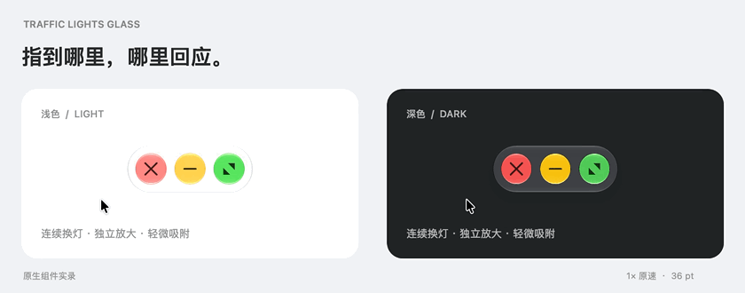
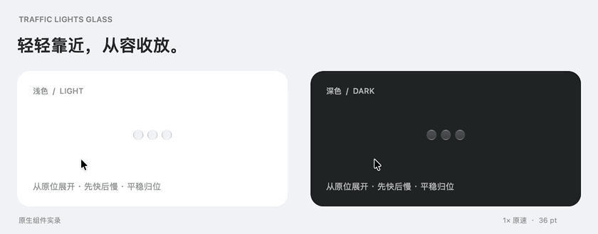
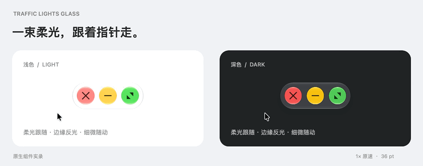
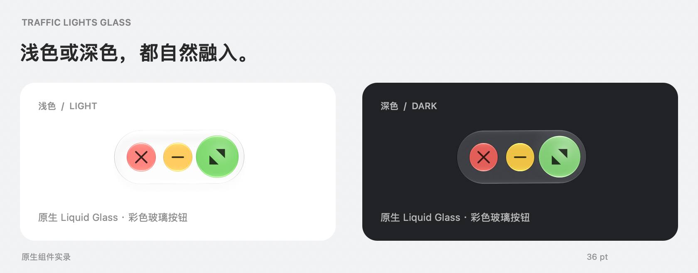
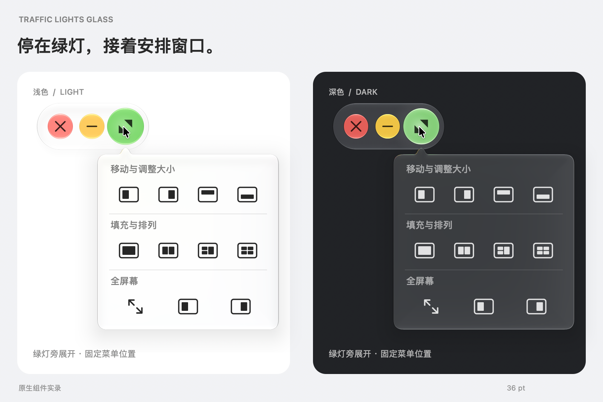

Traffic Lights Glass 首个公开版本。让 macOS 窗口红绿灯顺着你的指针动起来。

这次最想让你感受到的，是每次划过按钮时轻巧、连贯的回应。先看看实际效果：

### 指到哪里，哪里回应

只放大当前指向的灯，并轻微向指针靠近。滑向下一颗时，放大状态连续接续，胶囊随之伸展。

### 轻轻靠近，从容收放

隐藏式红绿灯从原来的小按钮位置展开；离开时平滑收回。先快后慢，落点稳定。

### 一束柔光，跟着指针走

按钮和胶囊共享柔和的指针光照。靠近边缘时，局部反光随之增强。

### 两种外观，同样细腻

停留在绿灯上，继续选择窗口布局。菜单对齐绿灯，朝菜单移动时留有进入余量。

本机原生组件录制，使用预设指针轨迹；GIF 为 50 帧/秒、1× 原速。环境：macOS 27.2.1，按钮尺寸 36 pt。菜单可用项依目标应用而定。[素材与录制说明](https://github.com/toriyoni/traffic-lights-glass/blob/main/docs/showcase/README.md)

### 新功能

- 原生液态玻璃胶囊和彩色红绿灯，保留系统材质、折射和边缘高光。
- 单灯独立放大、轻微指针吸附、先快后慢的动画，以及指针照明与边缘反光。
- 绿灯旁的窗口菜单：支持系统可用的平铺、排列和全屏操作；斜向进入保护和边缘容错不拦截外部点击。
- 应用名单优先于全局开关，可为 UU 远程等应用单独关闭放大。
- 透明度可跟随系统 Liquid Glass 设置，也可固定为清透效果。
- 接入本仓库 GitHub Releases 更新，更新清单与安装归档均使用独立 Ed25519 签名验证。
- 保留隐藏式红绿灯、按钮动作、Dock 点击最小化、台前调度关闭按钮和中英文设置。

### 下载与安装

- **Apple Silicon（M 系列）**：下载 `Traffic-Lights-Glass-1.0.0-arm64.dmg`。
- **Intel Mac**：下载 `Traffic-Lights-Glass-1.0.0-x86_64.dmg`。
- 打开 DMG，把 **Traffic Lights Glass.app** 拖入“应用程序”。ZIP 是另一种安装包，也是应用内更新使用的归档。
- 在“系统设置 → 隐私与安全性 → 辅助功能”中允许本应用操作窗口。

**首发尚未使用 Apple Developer ID 签名或进行 Apple 公证。** 下载后首次打开可能被系统拦截；确认下载来自本仓库后，按 [Apple 官方说明](https://support.apple.com/102445) 在“隐私与安全性”中允许打开。无需关闭 SIP 或全局 Gatekeeper。

### 系统要求与限制

- macOS 13 或更新版本；**原生 Liquid Glass 需要 macOS 26 或更新版本**，较早系统使用后备材质。
- 系统透明度覆盖及浮层原生高光使用了隔离的兼容处理，升级 macOS 后可能需要适配。
- 应用必须提供标准辅助功能窗口按钮；自绘标题栏和部分第三方窗口可能不支持。
- 全屏窗口内的红绿灯覆盖仍在开发中；绿灯菜单中的进入全屏操作可用。
- 已有本机定制版使用相同应用标识，尺寸、应用名单及其他设置可继续沿用。

---

First public release of Traffic Lights Glass: native Liquid Glass traffic lights, per-button hover magnification, pointer lighting, an anchored window menu with entry protection, per-app overrides, and system transparency following.

The previews above show the native components in light and dark appearances, recorded on macOS 27.2.1 with scripted pointer paths and 36 pt controls. All three GIFs play at their original speed at 50 fps: continuous hover transitions, gentle expansion and return, and pointer-driven lighting.

Choose **arm64** for Apple Silicon or **x86_64** for Intel. Drag the app into Applications and grant Accessibility access. macOS 13+ is required; native Liquid Glass requires macOS 26+.

This release is **ad-hoc signed and not Apple-notarized**. Follow Apple's linked guidance if first launch is blocked. Update feeds and archives are independently Ed25519-signed. Full-screen window overlays and nonstandard title bars remain limited.
