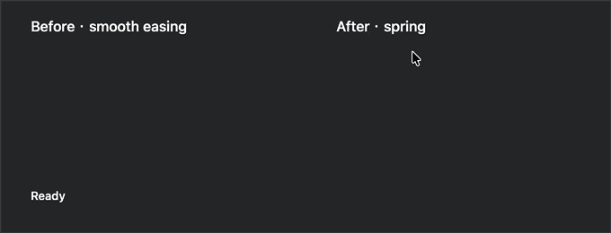

# 胶囊弹簧动画

2026-11-10，将液态玻璃胶囊的展开改为“先弹到略大于预设尺寸，再回落稳定”。

本文是首版弹簧动画（`513f940`）的历史记录。随后修正了中心位置和窗口取整问题，见 [中心稳定性修复](stable-capsule-center.md)。目前已按使用反馈取消回弹，改为先快后慢的缓出动画，见 [当前实现和对照](ease-out-capsule-animation.md)。

这是本机 macOS 27.2.1 上实际 `GlassGroupPanel` 的录屏，28 pt 按钮，正常播放速度。两侧共用当前原生玻璃材质；左侧使用上一版的 0.24 秒展开、0.18 秒收起及 smoothstep 插值，右侧使用新的弹簧。第二次展开中加入快速退出、重入，用来观察动画反向。测试窗口只展示覆盖层，不模拟底下应用的原生红绿灯。

## 原因与调整

旧实现虽然有加速和减速，但进度与几何插值都被限制在 0…1，无法超过预设大小。现在直接用弹簧的位移驱动按钮位置、直径、间隔和胶囊内边距，不再叠加 smoothstep 或在目标大小处截断。

- 展开使用角频率 22 rad/s、阻尼比 0.5 的欠阻尼弹簧，约 165 ms 达到第一次峰值。28 pt 示例中，胶囊由最终的 116 × 44 pt 弹到约 126 × 49 pt，再回落；最终按钮尺寸仍由现有设置决定。
- 收起使用角频率 30 rad/s 的临界阻尼。快速反向保留位移和速度，避免从固定起点重新播放。
- 用解析解推进弹簧，30 / 60 / 120 Hz 及短暂丢帧得到一致的时间响应。只有位移和速度都接近静止时才结束动画，经过目标尺寸时不会提前停止。
- 实际点击区域跟随每一帧的按钮尺寸；悬停保留区包含弹大的胶囊。遮挡检测包含最大超调范围，接近窗口边缘时平移整组以保留按钮间隔。
- 快速反向的极端位移设有上限；隐藏、常显模式与“减少动态效果”会清除弹簧速度。

玻璃材质和高光仍由 AppKit 绘制，动画参数由本项目调节；此处没有声称调用了 Apple 触屏控件的私有动画。

## 验证

- 97 项 Swift 测试通过，完整发布构建和签名验证通过。
- 新增或更新的测试覆盖超调后稳定停止、收起不反弹、快速反向保持速度、不同帧率与丢帧、无效时间、减少动态效果及状态重置。
- 布局测试覆盖 18 / 28 / 48 pt、负屏幕坐标和窗口两侧；超调期间按钮不重叠，正常大小的窗口能容纳胶囊。
- 本机对照程序直接使用编译出的 `GlassGroupRevealState`、`GlassGroupLayout` 和 `GlassGroupPanel`，在 182 个可见动画帧检查三个按钮的命中区域与实际尺寸一致，并确认面板没有成为 key/main window。
- 录屏观察到了展开超调、回落、收起及中途反向。此次没有重复验证 Finder 的关闭、最小化、绿灯菜单或多显示器切换。
