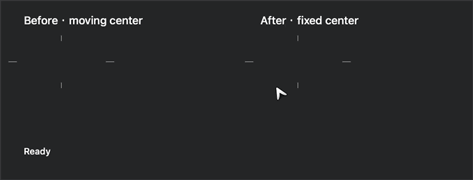

# 回弹末段的中心稳定性修复

2026-11-10，根据实际使用中可观察到的胶囊中心晃动，检查首版弹簧动画 `513f940` 的几何计算和 AppKit 窗口布局。

这是本机实际原生玻璃视图的录屏，使用用户当前的 24 pt 按钮尺寸，正常速度播放。左右使用相同的弹簧参数；背景短线标记各自最终中心。左侧直接编译 `513f940` 的布局与面板实现，右侧使用本次实现。

## 两个原因

1. 位置和尺寸都用同一个可超调进度插值。以 24 pt 为例，进度从 1 变为 1.16 时，布局中心从 `(56, 24)` 移到了 `(58.72, 24.8)`。弹簧回落时，这个位移也跟着回落。
2. 每帧都改变顶层 `NSPanel` 的原点和尺寸，AppKit 的窗口取整又叠加了小幅跳动。独立实验将请求中心始终固定在 `(642, 420)`，仍测到实际玻璃中心在末段落到 `(641, 419)`，最终再跳回 `(642, 420)`。

第二项实验的原始记录见 [修复前](glass-spring/center-before.csv)和[修复后](glass-spring/center-after.csv)。它只用于隔离窗口取整，不把位置插值造成的偏移混在一起。

## 修复

- 将中心接近目标位置的运动与尺寸回弹分开。进度达到 0.9 后，中心固定在最终位置，正常回弹中的超调和轻微欠调仅改变尺寸。
- 胶囊位于尺寸固定的透明窗口内，只有内部原生玻璃视图和按钮变化。以实际窗口原点换算内部坐标，避免将窗口取整误差传给玻璃。
- 回弹靠近窗口边缘时，根据固定中心两侧可用空间柔和限制超调幅度，不再通过逐帧推移胶囊来避让边界。
- 按钮、图标、点击区域和原生红绿灯遮罩使用同一份布局；悬停保留区使用可见胶囊的边界，区别于较大的透明窗口。

## 验证

- 99 项 Swift 测试通过，包含新增的固定中心回归检查和实际 `GlassGroupPanel` 布局测试。
- 几何检查覆盖 18 / 24 / 28 / 48 pt、左右边缘、负坐标和非整数原点；超调时中心固定且正常窗口能容纳胶囊。
- 实际 AppKit 测试检查窗口边界在整段动画中保持不变；回弹末段的可见玻璃中心、按钮中心与预期坐标误差小于 `0.000001 pt`，鼠标命中仍落在对应按钮上。
- 本机录屏程序检查 183 个可见帧的按钮命中。首次展开接近目标至稳定的采样中，旧版实际中心横向范围为 3 pt、纵向范围为 1.5 pt；修复后为 0 pt 和约 `1.14 × 10⁻¹³ pt`（浮点舍入量级）。
- 上述数据针对静止测试窗口；此次没有重复验证多显示器切换、Finder 原生绿灯菜单等其他交互。
