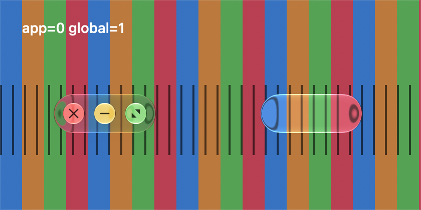
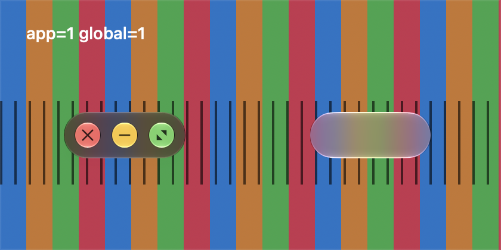
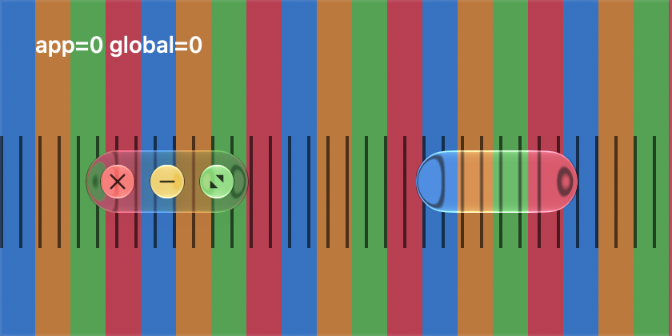

# System glass transparency and green-button menu

Validated on macOS 27.2.1, using the macOS 26.5 SDK. These checks cover native fixture windows and the current machine, rather than all OS versions or third-party windows.

## Appearance switch

Settings → Liquid Glass → **Follow System Glass Transparency** (中文：**透明度跟随系统**) defaults to on and persists across launches.

- On: the capsule, colored buttons, app-owned window menu and settings preview inherit System Settings → Appearance → Liquid Glass.
- Off: native material keeps the clear appearance in this application, independently of that system slider.
- Accessibility → Reduce Transparency remains respected by the existing accessibility fallback.

The slider described in [Apple's Appearance settings guide](https://support.apple.com/en-euro/guide/mac-help/mchlp1225/27/mac/27) is separate from the accessibility setting. The native material already inherited it; the missing feature was an effective app-local opt-out.

### Implementation and compatibility boundary

`GlassTransparency` applies only application-domain defaults: `NSGlassTintAmount = 0` and the older `NSGlassDiffusionSetting = false` when fixed clear is selected. Following removes both overrides, so future global changes continue to propagate; it does not copy the current global number. No global defaults are written by the application.

AppKit caches its glass environment. Writing defaults or recreating the panel alone did not refresh an existing process during the initial experiment. Posting `NSGlassEffectDiffusionDidChangeNotification` through the **local** notification center after the write refreshes both SwiftUI and AppKit glass, including already-open surfaces. It is not a distributed notification and does not change another app's settings.

These preference keys and the invalidation notification are undocumented compatibility behavior, isolated in one source file. There is no runtime method replacement, injected code, global appearance setter or custom opacity layer. The continuous slider was verified on macOS 27.2.1; the older binary preference is retained for macOS 26 compatibility but was not visually tested on a separate macOS 26 installation. Future OS changes require revalidation. The switch is shown on macOS 26.1 and later.

### Controlled native-material experiment

A separate bundled helper places the production capsule and colored buttons over fixed stripes. The right sample is an active-appearance native `.clear` view. The entire backdrop, appearance and geometry stay fixed. The system slider was temporarily moved from 0 to 1 and restored to its original 0 after the checks.

Both `.regular` and `.clear` follow the global slider; choosing `.clear` alone is not an opt-out. The verified app-domain override plus local refresh produces these states:

| App policy | System slider | Observed material |
| --- | --- | --- |
| Fixed clear | 1, heaviest tint | Remains clear while the system changes |
| Follow system | 1, heaviest tint | Native tint/diffusion appears immediately |
| Follow system | 0, clear | Returns to clear without relaunching |

`app` in the screenshots is the effective preference seen by the helper; `global` is the system-domain value.

## Green-button menu lifetime

The hover delay remains 0.5 seconds, but only the actual green button can start it. Shared click lanes between the colored buttons still work; those extended lanes do not count as green-button menu hover. Both the delayed task and the asynchronous accessibility snapshot completion recheck the pointer and request generation. A cancelled or stale request cannot show a late popup.

Once open, the actual green circle, menu shape and narrow route through the menu arrow keep it available. Red/yellow and external space close it synchronously; the old 0.25-second dismissal delay and large rectangular retention area are removed. The arrow stays at its captured position while the source hit region tracks the current green circle. Magnification and pointer lighting continue independently.

Automated native-window fixture checks confirmed: red/yellow dwell does not open the menu; leaving green before the delay cancels it; leaving without another presentation update is caught by the delayed recheck; re-entry can open again; the green-to-menu route stays clickable with a fixed anchor; moving to yellow closes immediately while yellow still enlarges; leaving outside closes immediately. Unit checks additionally cover above/below placement and a menu clamped at the right screen edge.
